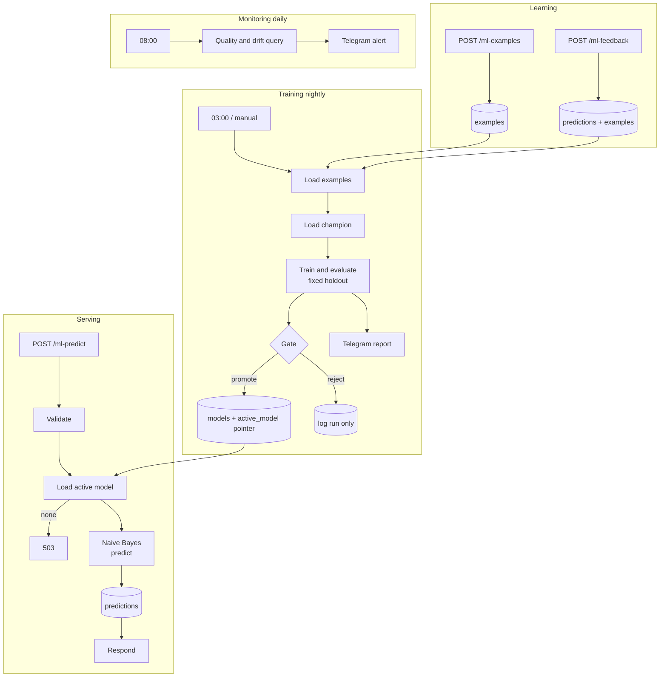

# ML Text Classifier Service for n8n

> A complete machine-learning loop inside n8n, with no external ML service: **serve predictions, collect human corrections, retrain every night, and promote a new model only if it is not worse than the one in production.** Includes drift and quality monitoring.


## Table of contents

1. [What it does](#what-it-does)
2. [Architecture](#architecture)
3. [The model](#the-model)
4. [Retraining and promotion](#retraining-and-promotion)
5. [API](#api)
6. [Setup](#setup)
7. [Monitoring](#monitoring)
8. [Configuration](#configuration)
9. [Database](#database)
10. [Security and privacy](#security-and-privacy)
11. [Testing](#testing)
12. [Troubleshooting](#troubleshooting)
13. [Limitations](#limitations)
14. [Roadmap](#roadmap)

## What it does

| Capability | Behavior |
|---|---|
| **Predict** | `POST /webhook/ml-predict` returns the label, confidence, top-3 alternatives and a `prediction_id`. Low-confidence answers are flagged for human review. |
| **Learn from feedback** | `POST /webhook/ml-feedback` attaches the correct label to a prediction. The corrected text becomes a training example. |
| **Bulk labels** | `POST /webhook/ml-examples` adds up to 200 labeled examples per call (and is the only way to introduce a new label). |
| **Retrain** | Every night at 03:00, plus a manual trigger. Trains on all examples with a fixed holdout. |
| **Gate** | A new model replaces the serving model only if it clears an accuracy floor and is not worse on the same holdout. |
| **Monitor** | Daily check of confidence, accuracy on feedback and label-distribution shift, with a Telegram alert. |

Typical uses: routing support tickets, tagging feedback, spam or intent detection, categorizing expenses.

## Architecture



## The model

**Multinomial Naive Bayes** on word unigrams and bigrams, implemented in plain JavaScript inside two Code nodes (`Train & Evaluate` and `Predict`), which share byte-identical tokenizer and scoring code.

- Text is lower-cased, stripped of accents, split into `[a-z0-9]+` words of 2+ characters. Bigrams are added.
- The vocabulary is the top 4000 terms that appear in at least 2 training examples.
- Laplace smoothing (alpha = 1). Unknown words are ignored at prediction time.
- The model is stored as JSON in PostgreSQL (typically well under 400 KB).

**Why Naive Bayes?** It trains in milliseconds on thousands of examples, needs no native libraries (n8n Code nodes cannot load them), is fully inspectable, and works well on small text datasets, which is exactly where a support team starts.

**Confidence.** Naive Bayes is over-confident on long texts, because every repeated word multiplies the evidence. Scores are divided by a temperature `T = max(1, matched_words / 8)` before the softmax. In the tests, a text that repeats conflicting evidence stays around 0.7 confidence at any length, while consistent evidence stays confident. This is a practical heuristic, **not** a calibrated probability. If you act on the number, calibrate it on your own feedback data.

**Unknown input.** A text with no word known to the model returns `label: null`, `confidence: 0`, `low_confidence: true`.

## Retraining and promotion

1. **Classes** with fewer than 5 examples are ignored and reported.
2. **Fixed holdout.** An example is in the holdout if `hash(id) % 5 == 0`. The assignment never changes, so no model, old or new, trains on a holdout example. The deployed model is the one evaluated, not a refit on all the data (a trade-off: 20% of the data is not used for the final model, but the metrics describe exactly what is in production).
3. **Evaluate** both the new model (the *challenger*) and the serving model (the *champion*) on the same holdout: accuracy, macro F1 and per-class precision, recall and F1.
4. **Gate.** The challenger is promoted only if:
   - accuracy is at least **0.6**, and
   - macro F1 is at least the champion's minus **0.005** (or there is no champion yet).
5. **Promotion is atomic.** One SQL statement inserts the model and moves the single-row `active_model` pointer. A failed insert leaves the old model serving.
6. Every run (promoted, rejected, skipped) is stored in `models` with its metrics and reason, and reported on Telegram.

Training is skipped, with a reason, if there are fewer than 30 usable examples, fewer than 2 classes, or fewer than 10 holdout examples.

### What to expect from the demo data

`sql/seed_examples.sql` has 120 short customer-support messages in 4 classes. On this data, 5-fold cross-validation gives roughly **0.80-0.83 accuracy**, and the built-in holdout (24 examples) measured **0.75 accuracy and 0.74 macro F1** in testing. With so few examples these numbers are noisy. It is a demo to prove the loop works; use your own data and aim for at least 100 examples per class.

## API

All endpoints need the header `X-API-Key: <your secret>`.

### Predict

```bash
curl -X POST "https://YOUR-N8N/webhook/ml-predict" \
  -H "X-API-Key: YOUR_SECRET" -H "Content-Type: application/json" \
  -d '{"text": "I forgot my password and cannot log in"}'
```

```json
{
  "prediction_id": 41,
  "label": "account",
  "confidence": 0.9312,
  "low_confidence": false,
  "alternatives": [
    {"label": "account", "probability": 0.9312},
    {"label": "technical", "probability": 0.0401},
    {"label": "billing", "probability": 0.0187}
  ],
  "model_id": 3
}
```

| Status | Meaning |
|---|---|
| 200 | Prediction made |
| 400 | `text` missing, empty, not a string, or over 5000 characters |
| 503 | No trained model yet. Run *Manual Train* |

### Feedback

```bash
curl -X POST "https://YOUR-N8N/webhook/ml-feedback" \
  -H "X-API-Key: YOUR_SECRET" -H "Content-Type: application/json" \
  -d '{"prediction_id": 41, "label": "technical"}'
```

| Status | Meaning |
|---|---|
| 200 | Saved. The text joins the training set with this label (latest label wins) |
| 404 | Unknown `prediction_id` |
| 422 | The label is not used by any training example. Add it with the examples endpoint first |
| 400 | Invalid body |

### Bulk examples

```bash
curl -X POST "https://YOUR-N8N/webhook/ml-examples" \
  -H "X-API-Key: YOUR_SECRET" -H "Content-Type: application/json" \
  -d '{"examples": [{"text": "Where is my order?", "label": "shipping"}]}'
```

Returns `{"status":"saved","received":1,"inserted":1,"relabeled":0,"total_examples":121}`. A repeated text keeps the last label.

## Setup

### Requirements

- n8n 1.x and PostgreSQL 13+ (generated columns are used)
- A Telegram bot and chat ID for reports (optional but recommended)

### Steps

1. **Create the tables:** run [`sql/schema.sql`](sql/schema.sql). Optionally run [`sql/seed_examples.sql`](sql/seed_examples.sql) for demo data. Both are safe to run twice.
2. **Import** `workflows/ml_text_classifier_service.json`.
3. **Credentials**

   | Credential | Type | Notes |
   |---|---|---|
   | Postgres account | Postgres | |
   | Telegram account | Telegram API | Bot token |
   | ML API key | Header Auth | Name `X-API-Key`, value is a long random secret you choose |

4. **Replace placeholders:** `REPLACE_WITH_ALERT_CHAT_ID` in the Telegram nodes, and `REPLACE_ID` in every credential slot.
5. **Set the Error Workflow** in Workflow Settings to this workflow.
6. **Train the first model:** execute *Manual Train*. You should get a "New model promoted" message.
7. **Activate** the workflow and call the predict endpoint.

## Monitoring

Every day at 08:00 a single query computes quality signals. A Telegram message is sent only when something needs attention:

| Alert | Condition |
|---|---|
| No active model | The pointer table is empty |
| Low confidence | More than 40% of the last 24 h predictions are low confidence (at least 20 predictions) |
| Poor accuracy on feedback | Under 70% of predictions that received a correction in the last 7 days were right (at least 20 corrections) |
| Label shift | Total variation distance above 0.3 between the last 24 h and the previous 7 days of predicted labels (at least 50 predictions in each window) |

Label shift is an early warning that the input data changed. It does not prove the model is wrong.

## Configuration

| Setting | Where | Default |
|---|---|---|
| Low-confidence threshold | `LOW_CONFIDENCE` in *Predict* | 0.6 |
| Minimum examples, per class, holdout | constants at the top of *Train & Evaluate* | 30, 5, 10 |
| Accuracy floor and F1 tolerance | `MIN_ACCURACY`, `TOLERANCE` in *Train & Evaluate* | 0.6, 0.005 |
| Max features, smoothing, holdout share | `MAX_FEATURES`, `ALPHA`, `TEST_MOD` | 4000, 1, 5 (1 in 5) |
| Training schedule | *Daily Training Schedule* | `0 3 * * *` |
| Monitoring schedule | *Daily Monitor Schedule* | `0 8 * * *` |
| Alert thresholds | *Format Monitor Alert* | see above |

If you change the tokenizer, edit it in **both** *Predict* and *Train & Evaluate*, then retrain. A model is only valid with the tokenizer that built it.

## Database

| Table | Purpose |
|---|---|
| `examples` | Labeled texts. `text_hash` (generated MD5) is unique: one label per text, latest wins |
| `models` | Every training run with metrics, champion metrics, decision and reason. The model blob is kept only for promoted runs |
| `active_model` | Single-row pointer to the serving model |
| `predictions` | Every served prediction, probabilities, and optional feedback |
| `model_history`, `label_counts` | Views for dashboards |

Housekeeping suggestion:

```sql
DELETE FROM predictions WHERE created_at < now() - interval '90 days' AND feedback_label IS NULL;
```

## Security and privacy

- **Authentication.** All three webhooks require a header API key. Use a long random value over HTTPS.
- **Input validation.** Text length is capped (5000 for predict, 2000 per training example), labels must match a strict pattern, feedback ids must be positive integers, bulk requests are capped at 200 items.
- **Label control.** Feedback cannot invent labels: unknown labels are refused with 422. New labels come only through the examples endpoint, which prevents label spam from polluting the model.
- **No prototype tricks.** Vocabulary lookups use `hasOwnProperty`, so words such as `constructor` or `toString` are treated as ordinary (unknown) words.
- **SQL.** Every query is parameterized.
- **Privacy.** Prediction texts are stored (truncated to 2000 characters) so feedback can turn them into training data. Do not send personal or confidential data unless that is acceptable for your database, and apply a retention policy (see above).
- **Poisoning.** Anyone with the API key can add examples or feedback. Keep the key private, and review rejected or sharply changed models in the Telegram reports.

## Testing

- **Code nodes: 89 checks.** Tokenizer and Naive Bayes round trip (train in one node, predict in another), determinism and row-order independence, accuracy on the demo data, prototype-name words, no-known-words input, accents, near ties, the length temperature, every gate rule (too little data, rare classes, noisy labels, equal, worse and better champions, champion with unknown classes), all input validators (including injection-style labels), report and alert formatting, and workflow structure (auth on every webhook, every path ends in a response, identical model code in both nodes).
- **SQL: 41 checks** on a real PostgreSQL engine (PGlite): constraints, generated hash, seed idempotency, atomic promotion and pointer safety on failed inserts, prediction logging, feedback paths (known, unknown, replaced, missing), bulk upsert counts, and the monitoring query with a computed total-variation example.

Testing found two defects, both fixed: the monitoring query used `ROUND(double precision, integer)`, which does not exist in PostgreSQL (it would have failed on every run), and the bulk-insert response reported the row count from before the insert (a statement does not see its own writes in other sub-queries).

Not verified: a live n8n instance and Telegram. The first real test should be training on your own data and one prediction end to end.

## Troubleshooting

| Problem | Fix |
|---|---|
| Predict returns 503 | No promoted model. Run *Manual Train*. Check the training report for the reason |
| "Training skipped: Not enough data" | Add examples. You need 30+ in at least 2 classes with 5+ each |
| "Accuracy ... is below the minimum 0.6" | Labels are noisy or classes overlap. Review the per-class scores in the report and the weak classes it lists |
| "Challenger macro F1 ... is worse than champion" | Expected sometimes. The champion keeps serving. Add more, cleaner examples |
| Feedback returns 422 | Add the label first via `/ml-examples` |
| Everything is low confidence | The text uses vocabulary the model has not seen. Add labeled examples that cover it |
| Non-English text gets `no known words` | The tokenizer keeps only Latin letters and digits (see Limitations) |

## Limitations

- **Latin script only.** Chinese, Japanese, Thai, Arabic and similar scripts produce no tokens. Accented Latin letters are folded to plain letters.
- **One label per text**, no multi-label output.
- **Naive Bayes** ignores word order beyond bigrams and cannot model interactions. A fine-tuned transformer or an embedding model would be more accurate on hard tasks.
- **Confidence is a heuristic**, not calibrated.
- **The model JSON is loaded from PostgreSQL on every request.** Fine for moderate traffic; for high traffic add caching or a separate service.
- **The holdout is small on small datasets**, so metrics move a lot between runs. Treat the gate as protection against clear regressions, not fine ranking.
- **No concept-drift handling** beyond the daily alerts.

## Roadmap

- Cache the active model in workflow static data keyed by model id
- Embedding-based classifier (pgvector) alongside Naive Bayes
- Cross-validation for small datasets
- Active learning: queue the lowest-confidence predictions for labeling
- Per-class thresholds and a confusion matrix in the report

## License

MIT. Add a `LICENSE` file to your repository.
